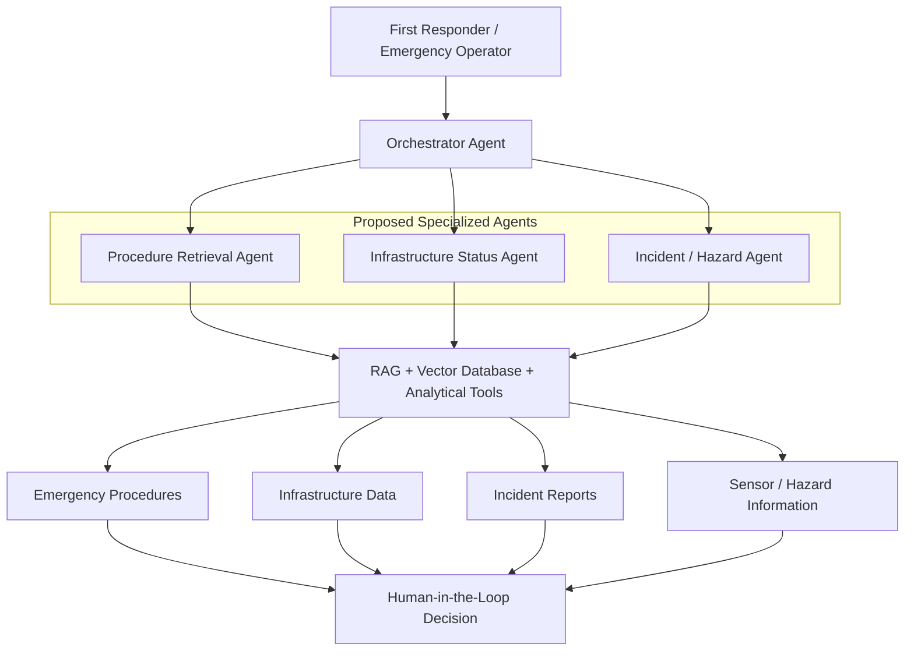

# RescueRAG: Agentic AI for Post-Disaster First Responder Decision Support

**Retrieval-Augmented Decision Support for First Responders and Post-Disaster Infrastructure Assessment**

## Overview

RescueRAG is a research concept/prototype exploring how an AI agent could support first responders after disasters. The proposed approach combines emergency-response procedures, infrastructure information, incident reports, hazard information, and simulated sensor or operational data through retrieval-augmented generation and tool-based analysis. Users would ask natural-language questions and receive grounded, situation-specific information to support human decision making. The architecture and capabilities described below are proposed, with implementation and demonstration planned as the next research steps.

## Motivation

First responders may need to rapidly interpret information distributed across emergency procedures, infrastructure records, road and utility status, incident reports, hazard information, sensor data, and operational guidance. This research investigates how agentic AI could retrieve relevant information, call analytical tools, and provide concise, evidence-based support while keeping interpretation and decisions with human responders.

## Proposed Architecture

**Proposed research architecture — not an implemented operational system.**

## Agent Roles

These roles describe planned capabilities; they do not imply autonomous emergency-response control.

### Orchestrator Agent

Would route each user request to the appropriate retrieval or analytical capability.

### Procedure Retrieval Agent

Would retrieve relevant emergency-response guidance, procedures, and safety information using RAG and vector retrieval.

### Infrastructure Status Agent

Would query structured information about roads, utilities, facilities, assets, or simulated operational conditions.

### Incident / Hazard Agent

Would review incident records, damage information, and hazard conditions to support situational awareness and scenario interpretation.

## Example First-Responder Queries

Illustrative questions for the planned prototype:

- "What response procedure applies to this infrastructure failure?"
- "Which infrastructure assets should be reviewed first?"
- "Which roads or facilities are currently unavailable?"
- "What information is most relevant to this incident?"
- "Which sensor values exceed the warning threshold?"
- "What should the responder review before entering this area?"
- "How would the situation change if a critical route became unavailable?"

## Proposed Data Sources

- Emergency-response manuals
- CERT / first-responder guidance
- Infrastructure asset records
- Inspection reports
- Road and utility status
- Incident logs
- Simulated sensor data
- Hazard reports
- Damage-assessment records

Demonstration data may be simulated or publicly available; these examples do not imply existing data integrations.

## Planned Agentic AI Capabilities

The following capabilities are planned, not claimed as implemented:

- Retrieval-augmented generation
- Vector database search
- Tool/function calling
- Document grounding
- Structured-data querying
- Incident-data retrieval
- Natural-language workflows
- Scenario-based what-if analysis
- Source traceability
- Human-in-the-loop recommendations
- Agent activity and audit logging

## Knowledge and Data Layer

The proposed prototype may use vector embeddings for document retrieval and structured JSON / CSV for incident and infrastructure data. Optional knowledge graphs could represent relationships among assets, hazards, facilities, and procedures. A knowledge graph is not currently claimed as an implemented component.

## Technology

Python • RAG • Vector Database • LLM Tool Calling • Streamlit

These describe the proposed technology stack, not a completed implementation. Candidate technologies include **FAISS / Chroma** for vector retrieval, **LangGraph** for orchestration, and **NetworkX** for optional graph modeling.

## Research Direction

The broader research direction connects post-disaster situational awareness and first-responder information support with infrastructure resilience. It aims to investigate human-agent collaboration and trustworthy AI decision support, including how source traceability and human review could inform future integration with AI-enabled digital twins.

## Status

**Research prototype / work in progress**

The proposed architecture is currently being developed as a lightweight research prototype. A future demonstration will combine emergency-response documents, infrastructure information, incident data, and an agentic RAG workflow.

## Future Demonstration

A short demonstration video and interactive prototype will be added as development progresses.

## Disclaimer

This project is a research prototype intended to support human decision making. It is not intended for autonomous emergency-response control or safety-critical operational deployment.
